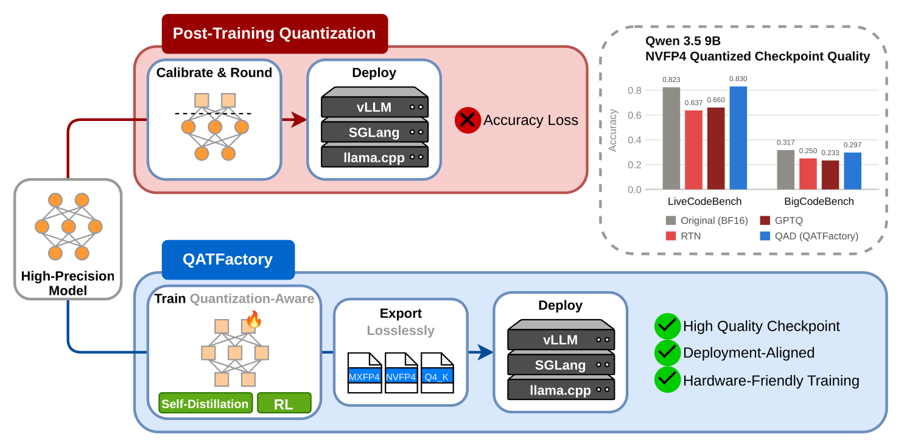
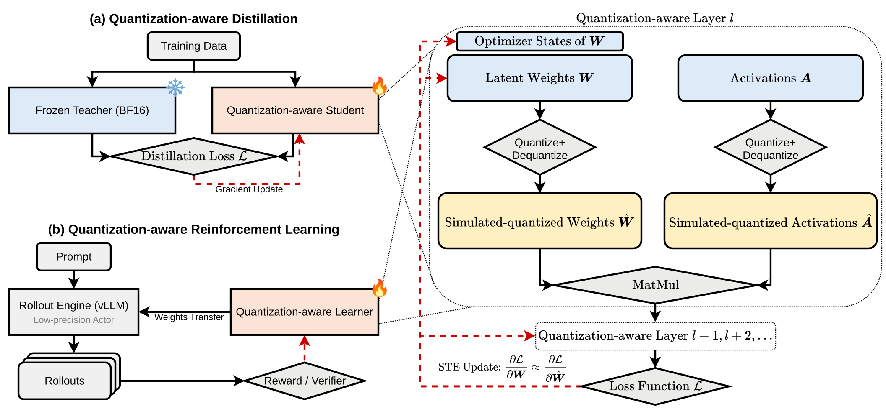
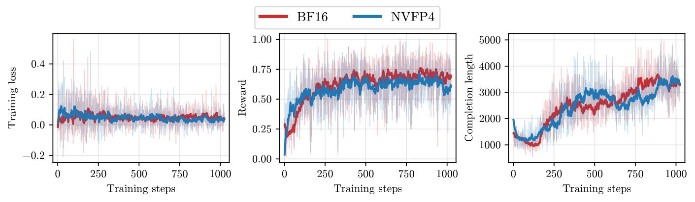

<!-- markdownlint-disable MD033 MD041 -->
<h1 align="center">QATFactory</h1>

<h3 align="center">
A Versatile, Deployment-Aligned Framework for Quantization-aware Training and Distillation of LLMs
</h3>

<p align="center">
  <a href="https://arxiv.org/abs/2609.39223"></a>
  <a href="https://huggingface.co/qatfactory"></a>
  <a href="LICENSE"></a>
</p>

**QATFactory fine-tunes a quantized LLM under the exact numerics it will be deployed with, then exports a checkpoint
that inference engines load as is.** It simulates NVFP4, MXFP4 and llama.cpp's Q4_K while every matmul runs in BF16,
so FP4 models train on GPUs without FP4 tensor cores. The same code trains dense and mixture-of-experts models from 8B
to 230B parameters, with full-parameter or LoRA updates, by distillation (QAD) or reinforcement learning (QARL).

On Qwen3.5-9B under NVFP4, QAD reaches an 8-benchmark average of **68.9%**, against **65.4%** for the best
post-training quantization (PTQ). Under MXFP4 the gap widens: **66.0%** for QAD, **56.4%** for the best PTQ.

<p align="center">
  
</p>
<p align="center"><i>Figure 1 of the paper. PTQ rounds a trained model and loses accuracy; QATFactory trains the model with
quantization in the loop and exports it without a second lossy conversion. On Qwen3.5-9B NVFP4, QAD keeps
LiveCodeBench and BigCodeBench close to BF16 where RTN and GPTQ drop.</i></p>

---

## News

- **2026-11**: Code release, with every training corpus and the reproduced checkpoints on
  [Hugging Face](https://huggingface.co/qatfactory).

## Highlights

- **Deployment-aligned numerics.** Each fake quantizer is bit-matched to the serving kernel's format (NVFP4 E2M1 with
  E4M3 block and FP32 tensor scales, MXFP4 with E8M0 block scales, Q4_K super-blocks), including the fused QKV and
  gate/up projections that engines share one scale across.
- **Lossless export.** The trained latents are packed directly into vLLM `compressed-tensors` checkpoints (NVFP4, MXFP4)
  or spliced into a llama.cpp GGUF (Q4_K): no re-quantization step and no extra inference cost.
- **Trains on the hardware you have.** Quantize-dequantize plus BF16 matmuls: NVFP4 QAD runs on H100s, which have no
  FP4 tensor cores.
- **Dense and MoE, full and LoRA.** Qwen3.5-9B, Qwen3-8B, DeepSeek-R1-Distill-Llama-8B, Qwen3-30B-A3B and MiniMax-M2.7
  (230B); LoRA-QAD fake-quantizes the merged weight, so the adapters learn what the deployed merge computes.
- **QAD and QARL.** Distill from the frozen BF16 model, or run GRPO whose rollouts come from the packed NVFP4 model in a
  colocated vLLM engine, re-synced bit-exactly after every optimizer step.
- **Reproducible.** Data recipes, generated corpora, training recipes, exporters and the evaluation harness are all
  here; the checkpoints in the [model zoo](#model-zoo) were retrained from them.

---

## How it works

<p align="center">
  
</p>

**(a) Quantization-aware distillation.** A frozen BF16 teacher and a quantization-aware student start from the same
checkpoint. Every target linear of the student quantizes and dequantizes its latent weight (and, for W4A4 training,
its input activation) to the deployment format before a BF16 matmul; the forward KL to the teacher's next-token
distribution flows back through a straight-through estimator to the latent weights and their optimizer state.

**(b) Quantization-aware RL.** The learner holds BF16 latents behind the same quantizers. A colocated vLLM engine serves
the packed NVFP4 export and generates the rollouts, rewards come from a verifier, and after each optimizer step the
latents are re-packed and published into the live engine, so the policy being sampled is the policy being deployed.

| | NVFP4 | MXFP4 | Q4_K |
|---|---|---|---|
| Element | E2M1 (4-bit float) | E2M1 (4-bit float) | 4-bit integer |
| Block size | 16 | 32 | 32 (in a 256 super-block) |
| Scales | E4M3 per block, FP32 per tensor | E8M0 per block | 6-bit per block, FP16 per super-block |
| Bits per weight | 4.50 | 4.25 | 4.50 |
| Training | W4A16 or W4A4 | W4A16 or W4A4 | W4A16 |
| Export | vLLM `nvfp4-pack-quantized` | vLLM `mxfp4-pack-quantized` | llama.cpp GGUF |

---

## Results

### Qwen3.5-9B and DeepSeek-R1-Distill-Llama-8B (paper Table 2)

Accuracy (%) and forward KL to the BF16 model; every quantized checkpoint is served at W4A4. *Avg* is the mean of eight
benchmarks (GPQA-Diamond, MMLU-Pro, MMMLU, Winogrande, HellaSwag, AIME25, LiveCodeBench, BigCodeBench); KL is the mean
over UltraChat, the Pile and WikiText.

| Qwen3.5-9B | GPQA-D | MMLU-P | AIME25 | LCB | BCB | Avg | KL |
|---|---|---|---|---|---|---|---|
| BF16 | 84.3 | 72.8 | 50.7 | 82.3 | 31.7 | 71.7 | — |
| NVFP4 RTN | 77.8 | 72.1 | 40.7 | 63.7 | 25.0 | 65.4 | 0.0778 |
| NVFP4 GPTQ | 71.2 | 71.8 | 34.0 | 66.0 | 23.3 | 63.3 | 0.1399 |
| **NVFP4 QAD** (trained W4A16) | 77.8 | 73.5 | 43.3 | 83.0 | 29.7 | **68.9** | **0.0682** |
| NVFP4 QAD (trained W4A4) | 78.3 | 71.4 | 47.3 | 78.3 | 28.0 | **68.9** | 0.0746 |
| MXFP4 RTN | 33.8 | 62.6 | 1.3 | 15.3 | 15.3 | 44.3 | 0.1792 |
| MXFP4 GPTQ | 63.1 | 68.0 | 27.3 | 39.0 | 16.3 | 56.4 | 0.1568 |
| MXFP4 QAD (trained W4A16) | 66.7 | 68.7 | 28.7 | 47.7 | 13.3 | 57.8 | 0.1510 |
| **MXFP4 QAD** (trained W4A4) | 74.8 | 71.8 | 44.0 | 72.3 | 20.0 | **66.0** | **0.1438** |

On DeepSeek-R1-Distill-Llama-8B (BF16 average 49.4) QAD lifts NVFP4 from 46.4 (best PTQ) to 47.7 and MXFP4 from 41.9 to
44.0. The best training precision is format-dependent: by held-out KL, NVFP4 does best when only weights are quantized
during training, MXFP4 when activations are quantized too.

### MoE and llama.cpp Q4_K (paper Table 3)

| Model | Format | Reference | PTQ | QAD | KL: PTQ → QAD |
|---|---|---|---|---|---|
| Qwen3-30B-A3B | NVFP4 | 66.86 | 64.27 | **65.78** | 0.0342 → **0.0324** |
| MiniMax-M2.7 (230B) | NVFP4 | 66.9 (FP8) | 66.6 | **69.1** | 0.0779 → **0.0697** |
| Qwen3-8B | Q4_K | 63.39 | 59.37 | **61.21** | 0.0628 → **0.0436** |
| Qwen3.5-9B | Q4_K | 69.93 | 57.64 | **64.57** | 0.0835 → **0.0623** |

Averages over GPQA-Diamond, AIME25, BigCodeBench and LiveCodeBench for the MoEs and over GPQA-Diamond and AIME25 for
Q4_K; the Q4_K baseline is llama.cpp's MSE-optimal quantizer and its KL is measured on WikiText.

### LoRA, sequence length and RL

- **LoRA-QAD** (Table 5): on Qwen3.5-9B NVFP4, rank-16 LoRA uses 2.9× less GPU memory than full-parameter QAD and
  reaches a 67.8 average (full QAD: 68.9; RTN: 65.4); raising the rank to 256 does not close the gap.
- **Long sequences generalize better** (Table 7): at a fixed token budget, training on fewer 32K-token sequences beats
  more 4K-token sequences by 1.9 average points (1.1 in this release's retraining, where 32K wins all four
  comparisons), and gains transfer across domains: code-trained checkpoints match or beat math-trained ones on AIME25
  in three of four settings.
- **QARL** (Tables 8 and 9): on Qwen3-8B-Base with GRPO on DeepMath, NVFP4 QARL trains 1.23× faster per step than BF16
  RL (33.96 s vs 41.83 s, mostly from faster NVFP4 rollouts) and averages 50.8 on five math benchmarks, against 48.1
  for BF16 RL followed by NVFP4 RTN.

<p align="center">
  
</p>

---

## Model zoo

Checkpoints retrained with the released recipes on the published corpora, in the
[`qatfactory`](https://huggingface.co/qatfactory) organization. Each model card lists the exact recipe, data revision,
training environment and its full evaluation next to the paper's numbers.

| Checkpoint | Format, training | KL to BF16 |
|---|---|---|
| [qatfactory/Qwen3.5-9B-NVFP4-QAD](https://huggingface.co/qatfactory/Qwen3.5-9B-NVFP4-QAD) | NVFP4, W4A16 | 0.0657 |
| [qatfactory/Qwen3.5-9B-NVFP4-QAD-W4A4](https://huggingface.co/qatfactory/Qwen3.5-9B-NVFP4-QAD-W4A4) | NVFP4, W4A4 | 0.0809 |
| [qatfactory/Qwen3.5-9B-MXFP4-QAD](https://huggingface.co/qatfactory/Qwen3.5-9B-MXFP4-QAD) | MXFP4, W4A16 | 0.1426 |
| [qatfactory/Qwen3.5-9B-MXFP4-QAD-W4A4](https://huggingface.co/qatfactory/Qwen3.5-9B-MXFP4-QAD-W4A4) | MXFP4, W4A4 | 0.1493 |
| [qatfactory/Qwen3.5-9B-NVFP4-LoRA-r4-QAD](https://huggingface.co/qatfactory/Qwen3.5-9B-NVFP4-LoRA-r4-QAD) | NVFP4, LoRA r=4 | 0.0672 |
| [qatfactory/Qwen3.5-9B-NVFP4-LoRA-r16-QAD](https://huggingface.co/qatfactory/Qwen3.5-9B-NVFP4-LoRA-r16-QAD) | NVFP4, LoRA r=16 | 0.0724 |
| [qatfactory/Qwen3.5-9B-NVFP4-LoRA-r64-QAD](https://huggingface.co/qatfactory/Qwen3.5-9B-NVFP4-LoRA-r64-QAD) | NVFP4, LoRA r=64 | 0.0879 |
| [qatfactory/Qwen3.5-9B-NVFP4-LoRA-r256-QAD](https://huggingface.co/qatfactory/Qwen3.5-9B-NVFP4-LoRA-r256-QAD) | NVFP4, LoRA r=256 | 0.1065 |
| [qatfactory/DeepSeek-R1-Distill-Llama-8B-NVFP4-QAD](https://huggingface.co/qatfactory/DeepSeek-R1-Distill-Llama-8B-NVFP4-QAD) | NVFP4, W4A16 | 0.1161 |
| [qatfactory/DeepSeek-R1-Distill-Llama-8B-NVFP4-QAD-W4A4](https://huggingface.co/qatfactory/DeepSeek-R1-Distill-Llama-8B-NVFP4-QAD-W4A4) | NVFP4, W4A4 | 0.1196 |
| [qatfactory/DeepSeek-R1-Distill-Llama-8B-MXFP4-QAD](https://huggingface.co/qatfactory/DeepSeek-R1-Distill-Llama-8B-MXFP4-QAD) | MXFP4, W4A16 | 0.2398 |
| [qatfactory/DeepSeek-R1-Distill-Llama-8B-MXFP4-QAD-W4A4](https://huggingface.co/qatfactory/DeepSeek-R1-Distill-Llama-8B-MXFP4-QAD-W4A4) | MXFP4, W4A4 | 0.2161 |

Finding 4 (Table 7), Qwen3.5-9B NVFP4 trained W4A16 on token-matched math or code splits; average of AIME25, BigCodeBench
and LiveCodeBench v6, served W4A16 / W4A4:

| Checkpoint | W4A16 | W4A4 |
|---|---|---|
| [qatfactory/Qwen3.5-9B-NVFP4-QAD-Math-4K](https://huggingface.co/qatfactory/Qwen3.5-9B-NVFP4-QAD-Math-4K) | 53.4 | 48.9 |
| [qatfactory/Qwen3.5-9B-NVFP4-QAD-Math-32K](https://huggingface.co/qatfactory/Qwen3.5-9B-NVFP4-QAD-Math-32K) | 53.9 | 51.0 |
| [qatfactory/Qwen3.5-9B-NVFP4-QAD-Code-4K](https://huggingface.co/qatfactory/Qwen3.5-9B-NVFP4-QAD-Code-4K) | 56.6 | 53.4 |
| [qatfactory/Qwen3.5-9B-NVFP4-QAD-Code-32K](https://huggingface.co/qatfactory/Qwen3.5-9B-NVFP4-QAD-Code-32K) | 57.6 | 54.4 |

BigCodeBench scores here run a few points above the paper's for every checkpoint, BF16 included, because the grader
build differs; compare checkpoints within a column.

The distillation corpora (Open Perfect Blend prompts answered by each model in thinking mode) are listed in
[docs/data.md](docs/data.md).

---

## Quick start

### Install

```bash
git clone https://github.com/QATFactory/QATFactory
cd QATFactory
pip install -e ".[flash]"          # torch, transformers >= 5.9, accelerate, datasets; FlashAttention-2
```

Extras: `.[q4k]` for GGUF export (plus a llama.cpp checkout), `.[rl]` for QARL (TRL, vLLM), `.[data]` for corpus
generation. Without FlashAttention, pass `--model.attn_implementation sdpa`.

### Serve a released checkpoint

```bash
vllm serve qatfactory/Qwen3.5-9B-NVFP4-QAD --max-model-len 65536
```

NVFP4 and MXFP4 run W4A4 on FP4 tensor cores (Blackwell); on Hopper vLLM serves the same checkpoint with FP4 weights and
BF16 activations.

| Engine | NVFP4 | MXFP4 | Q4_K |
|---|---|---|---|
| vLLM (0.30, the paper's engine) | W4A16, W4A4 | W4A4 on Blackwell, W4A16 elsewhere | — |
| SGLang (0.5.23) | W4A16, W4A4 | not in 0.5.23 (SGLang main serves it weight-only) | — |
| llama.cpp | — | — | GGUF |

An NVFP4 QAD checkpoint served by vLLM 0.30 or SGLang 0.5.23 matches QATFactory's training-side
simulation as closely as the simulation matches itself when only its attention kernel changes (SDPA vs eager):
forward KL about 0.002 for W4A16 and 0.05 for W4A4 on Qwen3.5-9B. Activation quantization amplifies any ulp-level
difference upstream, so W4A4 has this floor in every engine. Benchmarks agree as well: over three runs each, the
7-benchmark average of Qwen3.5-9B-NVFP4-QAD is 74.18 on SGLang and 74.17 on vLLM, while single runs vary by up to 0.9
points. See [docs/sglang.md](docs/sglang.md) for serving with SGLang and the full measurements.

### Train and export your own

```bash
# 1. data: the corpus the recipe expects under data/
hf download qatfactory/openperfectblend-100k-qwen3.5-9b-think --repo-type dataset \
  --revision 19edf87f0eed00f972bb277764a8eca5d0fe8031 --local-dir data

# 2. QAD (8 GPUs, FSDP2; any key can be overridden, e.g. --train.max_steps 1000)
torchrun --nproc_per_node=8 scripts/train_llm_qat.py configs/llm/qwen3_5_9b_nvfp4_qad.yaml

# 3. export to vLLM NVFP4
python scripts/export_nvfp4_vllm.py \
  --source outputs/Qwen3.5-9B-nvfp4-qad-openperfectblend-100k-1epoch-lr1e-6 \
  --model-assets Qwen/Qwen3.5-9B --output exports/Qwen3.5-9B-NVFP4-QAD
```

`bash examples/run_full_qwen35.sh` runs steps 2 and 3 in one go. Runs resume from their newest checkpoint with
`--train.resume_from_checkpoint <dir>`.

---

## Reproducing the paper

Each row below is one training recipe in [configs/llm/](configs/llm), one published corpus
([docs/data.md](docs/data.md)), one exporter and the evaluation harness ([docs/evaluation.md](docs/evaluation.md)).

| Paper result | Recipe(s) | Corpus | GPUs in the recipe |
|---|---|---|---|
| Table 2, Qwen3.5-9B | `qwen3_5_9b_{nvfp4,mxfp4}_qad[_w4a4].yaml` | `openperfectblend-100k-qwen3.5-9b-think` | 8 GPUs |
| Table 2, DeepSeek-R1-Distill-Llama-8B | `deepseek_r1_distill_llama_8b_{nvfp4,mxfp4}_qad[_w4a4].yaml` | `openperfectblend-100k-deepseek-r1-distill-llama-8b-think` | 8 GPUs |
| Table 3, Qwen3-30B-A3B NVFP4 | `qwen3_30b_a3b_nvfp4_qad.yaml` | `openperfectblend-100k-qwen3-30b-a3b-think` | 8 GPUs |
| Table 3, MiniMax-M2.7 NVFP4 | `minimax_m2_7_nvfp4_qad.yaml` | `openperfectblend-65536-minimax-m2.7-think` | 2 nodes × 8 |
| Table 3, Q4_K | `qwen3_8b_q4k_qad.yaml`, `qwen3_5_9b_q4k_qad.yaml` | Qwen3-8B / Qwen3.5-9B corpora | 8 GPUs |
| Table 5, LoRA ranks | `qwen3_5_9b_nvfp4_lora_qad.yaml --qad.lora.rank R --qad.lora.alpha 2R` | `openperfectblend-100k-qwen3.5-9b-think` | 8 GPUs |
| Table 7, sequence length and domain | `qwen3_5_9b_nvfp4_qad_generalization_*.yaml` ([docs/generalization.md](docs/generalization.md)) | `openperfectblend-generalization-qwen3.5-9b-think-32k` | 8 GPUs |
| Tables 8 and 9, QARL | `qwen3_8b_nvfp4_qarl.yaml` via `examples/run_qarl_qwen3_8b.sh` | `trl-lib/DeepMath-103K` | 4 GPUs |
| Table 8, BF16 GRPO baseline | `scripts/train_llm_grpo_bf16.py` with `qwen3_8b_nvfp4_qarl.yaml` (same data, reward and GRPO settings); `scripts/eval/rtn_export.sh` for its NVFP4 RTN row | `trl-lib/DeepMath-103K` | 4 GPUs |

The launch line for each recipe (single node, multi-node MoE, QARL) is at the top of the YAML. Export with
`scripts/export_nvfp4_vllm.py`, `scripts/export_mxfp4_vllm.py` or `scripts/export_q4k_gguf.py`; the PTQ baselines come from
`scripts/eval/rtn_export.sh` and `scripts/eval/gptq_export.py`.

Evaluate an export the way the tables do:

```bash
# one vLLM server per checkpoint, from an endpoints file (label|gpu|port|served_model_name|model_path)
bash scripts/eval/quality/serve_endpoints.sh my_endpoints.txt
# task accuracy with evalscope (GPQA-D, MMLU-Pro, MMMLU, Winogrande, HellaSwag, AIME25 x5, LiveCodeBench, BigCodeBench)
bash scripts/eval/quality/run_all_endpoints.sh "a b c d e" my_endpoints.txt
# forward KL to the endpoint labelled original-bf16 (override with TEACHER_LABEL) on UltraChat, the Pile and WikiText
bash scripts/eval/quality/run_kld.sh my_endpoints.txt
```

[docs/evaluation.md](docs/evaluation.md) pins the evaluation settings (sampling, limits, the BigCodeBench grader) and
lists the details that move scores. Expect single-sample benchmarks of 200–300 questions to vary by 2–3 points between
runs.

---

## Repository layout

```
qatfactory/
├── quant/formats/     # NVFP4, MXFP4, Q4_K fake quantizers (straight-through), packing, LoRA merge, FP8 base
├── quant/export/      # vLLM compressed-tensors exporters (NVFP4, MXFP4), MoE serving layouts
├── quant/fake_quant.py  # swap target linears for their quantization-aware version
├── models/            # Hugging Face loading, student / teacher construction
├── moe/               # teacher routing replay for MoE students
├── distill/           # KL distillation loss
├── trainer/           # QAD trainer (FSDP2), quantization-aware checkpointing and resume
├── rl/                # GRPO over quantized latents, live weight sync into vLLM
├── data/              # chat-template datasets with assistant-only loss masks
└── utils/             # config overrides, Hub resolution
scripts/               # train, export, corpus generation, MoE checkpoint fusing, evaluation
configs/llm/           # training recipes for every paper experiment
configs/data/          # corpus generation recipes
docs/                  # data, evaluation and generalization guides
tests/                 # numerics, export schema, trainer and RL unit tests (CPU)
```

## Acknowledgments

QATFactory builds on [Hugging Face Transformers](https://github.com/huggingface/transformers) and
[Accelerate](https://github.com/huggingface/accelerate) (FSDP2 training), [vLLM](https://github.com/vllm-project/vllm) and
[llm-compressor](https://github.com/vllm-project/llm-compressor) (serving format, GPTQ baselines),
[llama.cpp](https://github.com/ggml-org/llama.cpp) (GGUF and Q4_K), [TRL](https://github.com/huggingface/trl) (GRPO),
[torchao](https://github.com/pytorch/ao) (8-bit optimizers for the large MoEs),
[flash-linear-attention](https://github.com/fla-org/flash-linear-attention) (Qwen3.5 linear attention),
[EvalScope](https://github.com/modelscope/evalscope) (evaluation), and the
[Open Perfect Blend](https://huggingface.co/datasets/mlabonne/open-perfectblend) prompts.

## Citation

```bibtex
@misc{xu2026qatfactory,
  title         = {QATFactory: A Versatile, Deployment-Aligned Framework for Quantization-aware Training and
                   Distillation of LLMs},
  author        = {Xu, Weili and Li, Jisen and Jian, Yuqing and Li, Chenxi and Sha, Zhizhou and Yu, Yifan and
                   Wu, Qingyang and Xu, Chenfeng and Zhou, Zhongzhu and Zhang, Tianyi and Athiwaratkun, Ben},
  year          = {2026},
  eprint        = {2609.39223},
  archivePrefix = {arXiv},
  primaryClass  = {cs.LG},
  url           = {https://arxiv.org/abs/2609.39223}
}
```

## License

Apache License 2.0. See [LICENSE](LICENSE).
